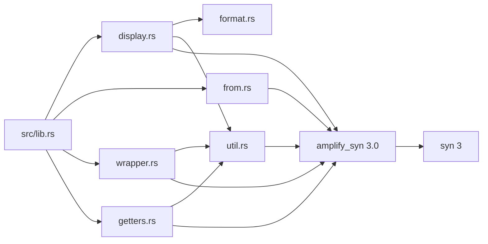

# Requirements

### Overview & Goals

Move the `amplify-derive` workspace (`amplify_derive` 4.0.1 and `amplify_syn` 2.0.1) to syn 3, edition 2024 and Rust 1.100, replace `amplify_syn` with a grammar-only 3.0 that every derive parses through, fix the 32 defects reproduced during analysis, and put the local macros under real tests.

### Decisions carried into this plan

**Yours**
- **syn version:** syn 3.
- **Minimum Rust version (MSRV):** 1.100.0 with edition 2024. This is my reading of "the one which allows all advanced features, up to 1.100"; say so if you meant something lower.
- **`amplify_syn`:** 3.0 holds the attribute grammar and the rules for attribute content, and is used by every derive. `DataType` and `DeriveInner` stay removed.
  - **Revised 2026-11-19 (step 7):** the first 3.0 was grammar-only and dropped `AttrReq`. That pushed validation into each derive by hand, most visibly in `src/getters.rs`. The rule layer (`AttrReq`, `ArgValueReq`, `ListReq`, `ValueClass`, `ParametrizedAttr`) is restored on top of the new grammar, with spans and without panics.
- **Downstream:** no compatibility with other derive crates is required.

**Mine (change them if you disagree)**
- **Versions:** `amplify_syn` 3.0.0 and `amplify_derive` 5.0.0. A major bump for `amplify_derive` keeps the MSRV jump and the stricter attribute checks away from crates that depend on `^4`.
- **Lints:** warnings in the manifest, denied only in CI. Commit `398d3fc` removed in-source `deny` attributes because they kept breaking builds.

### Does `amplify_syn` add value?

**As it stands, not to `amplify_derive`.**
- Only `src/getters.rs:20` imports it; the other three attribute-parsing modules parse by hand.
- It cannot express two of the four grammars: `#[from(&'static str)]`, `#[from([u8; 4])]`, `#[from(!)]` and bare `#[from]` fail to parse, and `#[display("a", "b")]` is silently joined into `"ab"`.
- Every error loses its span (`syn/src/error.rs:158-160`), and `#[getter(prefix = 5)]` panics.
- syn 3 parses `name = value` arguments and bare paths natively, with spans.
- Its requirement tables overlap with `darling 0.24.1` (on syn 3), which gave better diagnostics in my earlier test at the cost of five extra crates.

**What syn 3 does not give you** is the mixed positional form, such as `#[display("fmt", alt = "...")]` or `#[from(&'static str)]`, read uniformly across repeated attributes. That is the part 3.0 keeps. My scratch prototype of it is 203 lines against 3,069 today, and it parses every form listed above.

### Scope

**In scope**
- Rewrite `amplify_syn` as a grammar-only 3.0 on syn 3.
- Port `amplify_derive` to syn 3, edition 2024 and the new grammar.
- Fix all defects in the Defect List tab, each with a regression test.
- Add an integration test suite and compile-fail tests; make doctests exercise local code.
- Update manifests, lints, CI workflows, README, changelogs and `MANIFEST.yml`.

**Out of scope**
- Publishing to crates.io.
- The `amplify` repository. Its `proc_attr` feature re-exports `amplify_syn` and will need a follow-up there.
- The other derive crates that use `amplify_syn` 2 (`strict_encoding_derive`, `commit_encoding_derive`, `rgb-strict-encoding-derive`). They keep working on 2.0.1 and need a rewrite to move to 3.0.
- New derive macros or new attribute options. The one addition is implicit `{}` placeholders in `Display`, which fail to compile today.
- File licence headers. They mention the MIT licence and a public-domain dedication while `Cargo.toml` says `Apache-2.0`; that is yours to resolve.
- The contents of the `test/wasm` stub crate.

### User Stories

- As a user of the derives, I want a mistake in an attribute to be reported at the argument I got wrong, so that I can fix it without reading macro source.
- As a user of the derives, I want documented options such as `#[wrapper(NoRefs)]` to work, so that I do not hit macro panics.
- As the maintainer, I want one small attribute parser shared by all derives, so that there is one place to fix and test.
- As the maintainer, I want tests that run my local code, so that a regression cannot hide behind the published crate.

### Functional Requirements

1. **Toolchain:** the workspace builds and tests on Rust 1.100.0, edition 2024. `cargo tree -e normal -p amplify_derive` shows syn 3 and no syn 1.
2. **`amplify_syn` 3.0:** exposes the grammar (`Attr`, `Form`, `Arg`, `NamedArg`, `Value`) and the rule layer (`AttrReq`, `ArgValueReq`, `ListReq`, `ValueClass`, `ParametrizedAttr`). Each derive declares the content of its attributes as an `AttrReq` and does no validation of names, value kinds, defaults or repetition itself.
3. **Existing behaviour:** every attribute form documented in `src/lib.rs` keeps working. The 21 passing doctests still pass, and the ignored never-type doctest (`src/lib.rs:371`) runs.
4. **Defects:** every row in the Defect List is fixed and covered by a test that fails on today's code.
5. **Diagnostics:** malformed attributes never panic the macro. Each error points at the offending argument or attribute name, and independent errors are reported together.
6. **Intended behaviour changes:**
   - A second `#[display]` on one item is an error; today it is ignored.
   - A malformed `#[amplify_crate]` is an error; today it is ignored.
   - `{{0}}` in a format string stays a literal `{0}`.
   - `#[display("{1}")]` on a tuple variant prints field 1.
   - `From<Wrapper> for Inner` is not generated when the inner type is a bare type parameter.
   - `#[display("{}")]` numbers its placeholders in order.

### Non-Functional Requirements

- **MSRV** 1.100.0 is declared in both manifests, the README, `MANIFEST.yml` and the CI matrix.
- **Dependencies:** `amplify_derive` keeps the same four (`syn`, `quote`, `proc-macro2`, `amplify_syn`). `trybuild` is added as a dev-dependency only.
- **Safety:** no `unsafe`. There is none today; `unsafe_code = "forbid"` enforces it.
- **Lint state:** `cargo clippy --workspace --all-targets -- -D warnings` passes. Today it reports 15 warnings.

# Technical Design

### Current Implementation

**Layout**
- Root package `amplify_derive` (proc-macro, 3,812 lines in `src/`) and workspace member `syn/` (`amplify_syn`, 3,069 lines).
- `src/lib.rs` defines seven derives: `Display`, `Error`, `From`, `AsAny`, `Getters`, `Wrapper`, `WrapperMut`.
- Both crates are on `syn 1.0.109`, edition 2021. Declared MSRV is 1.66.0 and 1.60.0.

**Attribute parsing uses three styles**
- syn 1 `parse_meta()` and `NestedMeta`: `src/display.rs:128-194` and `542-559`, `src/wrapper.rs:1149-1166`, `src/util.rs:57-161`.
- `attr.tokens` and `parse_args()`: `src/from.rs:189-206`.
- `amplify_syn::ParametrizedAttr` with `AttrReq` tables: `src/getters.rs:33-83`.

**Tests**
- 21 doctests pass, 1 is ignored, and there is 1 unit test (`ident` in `syn/src/lib.rs`).
- Five doctests import a derive name from `amplify` (`src/lib.rs:406`, `712`, `728`, `747`, `822`). With `amplify`'s default features that name resolves to the registry `amplify_derive 3.0.1`. I confirmed this for `Wrapper`; the others import the same way.

**Tooling**
- CI uses `actions-rs/toolchain` and `actions-rs/cargo`, both archived, and `actions/checkout@v2`. The matrix tests 1.66.0.
- `README.md:18` says MSRV 1.60.0, and the crates.io badge on line 7 returns 404.
- `CHANGELOG.md` stops at 2.10.0 and `syn/CHANGELOG.md` at 1.1.0.

### Key Decisions

| Decision | Choice | Reason |
|---|---|---|
| syn version | 3 | Your choice; one breaking release for `amplify_syn` instead of two |
| MSRV and edition | 1.100.0, edition 2024 | Your choice |
| `amplify_syn` | Grammar-only 3.0, used by all derives | Your choice; keeps the one part syn 3 does not provide |
| Errors | Plain `syn::Error`, no custom error type | Spans come for free and errors combine |
| Value typing | Parsed eagerly into `Lit`, `Type` or `Expr` | Matches the grammar the crate has always documented; the rule is tested on 34 inputs |
| Stage order | Root crate uses the published `amplify_syn 2.0.1` for one stage | Keeps the workspace building between the rewrite and the port |
| Versions | `amplify_syn` 3.0.0, `amplify_derive` 5.0.0 | Breaking API and an MSRV jump |
| Lints | `[workspace.lints]` at warn; CI denies | Respects commit `398d3fc` |
| Diagnostics tests | `trybuild` compile-fail tests | Checks message and span together |

### Proposed Changes

**A. `amplify_syn` 3.0**
- Replace the whole crate with a parser for the four forms it has always documented: `#[name]`, `#[name = value]`, `#[name(arg, ...)]`, where an argument is a literal, a type, or `name = value`.
- Each parsed node implements `ToTokens`, so `syn::Error::new_spanned` points at it.
- Repeated attributes are returned as separate occurrences in source order. `From` needs each one; the other derives iterate over all of them.
- No requirement tables, no derive skeleton, no `ident!` or `path!` macros.

**B. Port of `amplify_derive`**
- All attribute parsing goes through `amplify_syn::Attr`. The syn 1 helpers in `src/util.rs` are deleted.
- `src/util.rs` keeps two shared pieces: resolving `#[amplify_crate(path)]` with a spanned error, and an error accumulator.
- `Getters` replaces its `HashMap<String, ArgValue>` handling with a typed options struct. The override rules between type-level and field-level arguments stay as documented in `src/lib.rs:531-584`.
- `#[macro_use] extern crate` lines become `use` imports.

**C. Code generation**
- A format-string scanner (`src/format.rs`) replaces the substring matching in `fix_fmt` and `has_formatters` (`src/display.rs:358-394`).
- `Display` on enums binds exactly the fields each format string uses, and the formatter parameter gets `Span::mixed_site()` hygiene.
- `Wrapper` and `WrapperMut` generate their formatting, indexing and operator impls from tables instead of about fifty hand-copied `quote!` blocks. One of the reproduced defects is a copy-paste slip between two of those blocks.
- All generated code uses fully qualified paths.
- Per-defect fixes are in the Defect List tab.

**D. Tooling and docs**
- Workspace-level package fields, dependency versions and lints.
- CI moves off the archived actions and tests 1.100.0.
- README, changelogs, `MANIFEST.yml` and the rustdoc in `src/lib.rs` are brought in line with the code.

### Data Models / Contracts

**`amplify_syn` 3.0 public API** (as prototyped)

```rust
/// One occurrence of an attribute.
pub struct Attr { pub path: Path, pub form: Form }

pub enum Form {
    Bare,                                // #[name]
    Value(Value),                        // #[name = value]
    List(Punctuated<Arg, Token![,]>),    // #[name(arg, ...)]
}

pub enum Arg { Lit(Lit), Type(Type), Named(NamedArg) }
pub struct NamedArg { pub name: Ident, pub eq_token: Token![=], pub value: Value }
pub enum Value { Lit(Lit), Type(Type), Expr(Expr) }

impl Attr {
    pub fn parse(attr: &Attribute) -> syn::Result<Self>;
    /// All occurrences of `#[name ...]`, in source order.
    pub fn find_all<'a>(attrs: impl IntoIterator<Item = &'a Attribute>, name: &str)
        -> syn::Result<Vec<Self>>;
    pub fn args(&self) -> impl Iterator<Item = &Arg>;
    pub fn error(&self, msg: impl Display) -> syn::Error;   // at the attribute name
}
impl Arg {
    pub fn as_ident(&self) -> Option<&Ident>;   // `as_copy`, `Debug`, `NoRefs`
    pub fn as_path(&self) -> Option<&Path>;     // `Type::function`
    pub fn error(&self, msg: impl Display) -> syn::Error;
}
impl Value {
    pub fn lit_str(&self) -> syn::Result<&LitStr>;   // "expected a string literal"
    pub fn error(&self, msg: impl Display) -> syn::Error;
}
// Parse for Arg and Value; ToTokens for Arg, NamedArg and Value.
```

**Value classification rule**
1. A literal, if the whole value is one.
2. Otherwise a type, if the whole value parses as one.
3. Otherwise an expression.
4. Exception: when both readings fit and the expression is a call or method call (`Vec::<u8>::new()`), it is an expression.

**`src/util.rs`**

```rust
/// `#[amplify_crate(path)]`, default `amplify`; malformed input is an error.
pub(crate) fn amplify_crate(input: &DeriveInput) -> syn::Result<Path>;

/// Collects independent errors and reports them together.
pub(crate) struct Errors(Option<syn::Error>);
impl Errors {
    pub fn push(&mut self, err: syn::Error);
    pub fn finish(self) -> syn::Result<()>;
}
```

**`src/format.rs`**

```rust
pub(crate) enum ArgRef { Index(usize), Name(String) }

pub(crate) struct Format {
    /// The string with every positional reference rewritten to `_N`.
    pub text: String,
    /// Every field referenced, as a value or as a width/precision parameter.
    pub args: Vec<ArgRef>,
}

pub(crate) fn scan(fmt: &str) -> Result<Format, String>;
```

Scanner rules:
- `{{` and `}}` are left alone.
- `{N}` becomes `{_N}`; `{}` is numbered in order.
- `name$` and `N$` inside a format spec count as references.
- Whitespace before `}` is accepted.

### Revision for step 7: the rule layer

Step 7 supersedes three statements in this tab: `amplify_syn` is not grammar-only, `src/util.rs` holds no error accumulator, and `Getters` has no hand-written options parser.

**`amplify_syn` rule layer (as built)**

```rust
pub enum ValueClass { Lit, Str, ByteStr, Char, Int, Float, Bool, Type, Path, Ident, Any }

pub enum ArgValueReq {
    Prohibited,                                              // a flag
    Optional(ValueClass),
    Required { class: ValueClass, default: Option<Value> },  // a bare name holds the default
}
impl ArgValueReq { required(class), with_default(value) }

pub struct ListReq { /* classes, accepted names, minimum, maximum */ }
impl ListReq { deny(), one(class), maybe_one(class), any(class), any_of(names), or(class) }

pub struct AttrReq { /* private */ }
impl AttrReq {
    pub fn new(name: &'static str) -> Self;
    pub fn arg(self, name, value: ArgValueReq) -> Self;        // may be left out
    pub fn mandatory(self, name, value: ArgValueReq) -> Self;  // must be given
    pub fn conflict(self, name, others: &[&'static str]) -> Self;
    pub fn unnamed(self, list: ListReq) -> Self;
    pub fn name_value(self, class: ValueClass) -> Self;        // `#[name = value]` reads as `#[name(value)]`

    pub fn single(&self, attrs) -> Result<Option<ParametrizedAttr>>;  // at most one occurrence
    pub fn merged(&self, attrs) -> Result<ParametrizedAttr>;          // all occurrences as one
    pub fn each(&self, attrs) -> Result<Vec<ParametrizedAttr>>;       // occurrence by occurrence
    pub fn check(&self, occurrences: &[Attr]) -> Result<ParametrizedAttr>;
}

pub struct ParametrizedAttr { /* private */ }
impl ParametrizedAttr { span(), has(name), value(name), str(name), unnamed(), error(msg), error_at(name, msg) }
```

**Rules declared by the derives**

| Attribute | File | Rules | Read |
|---|---|---|---|
| `getter` | `src/getters.rs` | `prefix`, `as_copy`, `as_clone`, `as_ref`, `as_mut` with string defaults; flag `all`; on fields also flag `skip` and `base_name = "..."`; `all` excludes the four method arguments, `as_copy` excludes `as_clone` | merged |
| `display` on types and variants | `src/display.rs` | one string or path; `alt = "..."`; `#[display = "..."]` allowed | single |
| `display` on fields | `src/display.rs` | mandatory `separator = "..."` | single |
| `from` | `src/from.rs` | at most one type | each |
| `wrapper`, `wrapper_mut` | `src/wrapper.rs` | any number of the trait names; the names are the variants of the `Wrapper` and `WrapperMut` enums | merged |
| `wrap` | `src/wrapper.rs` | no arguments | single |
| `amplify_crate` | `src/util.rs` | one path | single |

**Checks which stay in the derives**, because they concern the item and not the content of one attribute: `alt` only next to a format string, `inner` only with a single field, a bare `#[from]` only with a single field, a type used by `#[from]` once per item, and one wrapped field per wrapper.

**Getter names** are emitted as raw identifiers (`r#name`), so no keyword list is kept. A name the lexer rejects, such as `self` or `get-value`, is a spanned error.

### File Structure

```
Cargo.toml                 modified  workspace tables, version 5.0.0, syn 3
Cargo.lock                 regenerated
src/lib.rs                 modified  imports, entry points, rustdoc fixes
src/util.rs                rewritten
src/format.rs              new       format-string scanner
src/display.rs             modified
src/from.rs                modified
src/wrapper.rs             modified  table-driven generators
src/getters.rs             modified  typed options
src/error.rs, as_any.rs    modified
tests/display.rs           new
tests/from.rs              new
tests/wrapper.rs           new
tests/getters.rs           new
tests/error_as_any.rs      new
tests/ui.rs                new       trybuild driver
tests/ui/*.rs, *.stderr    new       compile-fail cases
syn/Cargo.toml             modified  version 3.0.0
syn/src/lib.rs             rewritten
syn/src/attr.rs            rewritten Attr, Form
syn/src/arg.rs             new       Arg, NamedArg, Value
syn/src/{cls,data,error,parsers,req,val}.rs   deleted
syn/README.md, syn/CHANGELOG.md               modified
README.md, CHANGELOG.md, MANIFEST.yml         modified
.github/workflows/{build,test,lint,codecov}.yml   modified
```

### Architecture Diagram

Every attribute-parsing module reads attributes through `amplify_syn`; only `display.rs` uses the format scanner.



### What was checked in scratch, and what was not

**Checked on Rust 1.100.0 (the repository itself is untouched)**
- The grammar prototype runs 34 cases with syn 3's default features, including every form `amplify_syn` 2.0.1 rejects.
- Four mini-derives built on it accept all current `display`, `from`, `wrapper` and `getter` syntax, and report 14 errors in one pass on a bad input, each at the offending token.
- The intermediate state of stage 2 (root on registry `amplify_syn 2.0.1`, member at 3.0.0 on syn 3) builds and passes all tests.
- With `amplify` at `default-features = false`, all 21 doctests pass against local code.
- The planned generated-code shapes compile: `Self { 0: ..., ..self }`, union `Self { a: v.into() }`, `Self::A {}`, `{_0:>_1$}`, `::core::error::Error`, and a mixed-site formatter next to a field named `f`.

**Not checked**
- `amplify_derive` as a whole has not been compiled against syn 3.
- The format scanner is specified but not prototyped.
- CI workflows and the wasm jobs cannot be run locally.

### Risks

- **Port surprises.** Mitigation: stage 1 tests pin current behaviour before the port.
- **Compile-fail snapshots depend on the compiler version.** Mitigation: run them on the stable job only; regenerate with `TRYBUILD=overwrite`.
- **Type-or-expression ambiguity in `Value`.** No derive in this workspace uses type or expression values, so the rule only affects other users of `amplify_syn`.
- **Behaviour changes break code that relied on a bug.** Mitigation: they are listed in the changelog under a major version.
- **`amplify`'s `proc_attr` feature will not compile against 3.0.** It stays on 2.0.1 until that repository is updated.
- **Getter override rules are subtle** (`src/getters.rs:341-360`). Mitigation: the three doctests at `src/lib.rs:512-584` and new tests cover them.

# Defect List

### How to read this

- Every row was reproduced by compiling a probe against an unmodified copy of the repository on Rust 1.100.0, and re-run today, unless marked "by reading".
- **32 reproduced defects:** 27 through the derives and 5 in the `amplify_syn` 2 API. Round one reported 23; I found nine more afterwards.
- Line numbers refer to the current files.

### `Display` (`src/display.rs`)

| ID | What happens | Where | Fix |
|---|---|---|---|
| D1 | A variant whose `alt` string uses a field the main string does not fails to compile (`cannot find value`). Named and tuple variants. | 683, 720: the alternate arm binds `idents`, not `idents_alt` | Each arm binds the fields its own string uses |
| D2 | A tuple variant prints the wrong field when the string skips an index: `#[display("{1}")]` on `V(1, 2)` prints `1`. | 717, 720, 726: pattern built from the filtered list | Pattern lists every position, `_` for unused ones |
| D3 | A variant field named `f` collides with the formatter: `cannot write into &u8`. | 680-691 | Formatter identifier uses `Span::mixed_site()` |
| D4 | A union without a type-level `#[display]` generates `Self::<field>` match arms: E0599. | 804-816, 838-843 | Spanned error asking for a type-level attribute |
| D5 | Escaped braces are rewritten: `{{0}}` prints `{_0}`. | 358-387 (`fix_fmt`) | Format scanner |
| D6 | A second `#[display]` on one item is silently ignored. | 127 (`.find`) | Error at the second attribute |
| D7 | A malformed field attribute (`separator = a b`) panics the macro. | 542 (`parse_meta().unwrap()`) | Spanned error |
| D8 | A field used only as width (`{x:>w$}`) or followed by a space (`{x }`) is not passed: E0425. | 390-394 (`has_formatters`) | Format scanner |

### `From` (`src/from.rs`)

| ID | What happens | Where | Fix |
|---|---|---|---|
| F1 | `#[from(T)]` on a variant with two or more named fields emits unparsable tokens. | 157: no `::`, no commas | `Self::V { a: Default::default(), ... }` |
| F2 | The duplicate-type error says "repeated use of type `ty`" and points at the derive. | 261-265 | Name the type; point at the second attribute |
| F3 | `#[from(T)]` on an empty braced variant `A {}` emits `Self::A`: E0533. | 53 | Construct by field kind: `Self::A {}`, `Self::A()` |
| F4 | On a union it emits `..Default::default()` inside a union literal: E0436. | 125, reached from 326-330 | `Self { a: v.into() }` |

### `Wrapper` and `WrapperMut` (`src/wrapper.rs`)

| ID | What happens | Where | Fix |
|---|---|---|---|
| W1 | `#[wrapper(NoRefs)]` and `#[wrapper_mut(NoRefs)]`, both documented, panic with `unreachable!()`. | 1168-1170 leave `NoRefs` in the list; 637-644, 982-986 | Remove the marker after filtering |
| W2 | `FromStr` breaks when the caller has its own `Result` alias. | 251; `FromHex` at 292-296 has the same pattern (by reading) | Fully qualified paths |
| W3 | `WrapperMut` on a type with bounded generics (`G<T: Clone>`): E0229. | 758, 777: `impl_generics` in type position | `<Self as Wrapper>::Inner` |
| W4 | `Index` on a type with a defaulted parameter (`V<T = u8>`) is rejected. | 398-482: raw `generics.params`; 801-873 same pattern (by reading) | `impl_generics` from `split_for_impl()` |
| W5 | `IndexToInclusive` names `RangeInclusive` in `Output`: E0277. | 470 | Correct type, from the shared table |
| W6 | `IndexMut` with `AsSliceMut`: `self.as_mut()` is ambiguous, E0282. | 805-877 | Index the field through the trait path |
| W7 | A struct with no fields (`S {}`, `S()`) panics the macro. | 1078, 1106 (`fields[0]`) | Spanned error |
| W8 | Operator traits on a multi-field wrapper omit the other fields: E0063. | 501-633 | `Self { field: ..., ..self }` |
| W9 | A wrapper over a bare type parameter (`W<T>(T)`) breaks orphan rules: E0210. | 1025 | Skip `From<W<T>> for T` in that case |
| W10 | A malformed `#[amplify_crate = "..."]` is silently ignored. | `src/util.rs:47-54` | Spanned error |

### `Getters` (`src/getters.rs`, through `amplify_syn` 2)

| ID | What happens | Where | Fix |
|---|---|---|---|
| G1 | `#[getter(prefix = 5)]` panics the macro. | `syn/src/req.rs:183`, reached from `src/getters.rs:83` | "expected a string literal" at the value |
| G2 | A misspelled argument (`as_cpoy`) reports "prohibits arguments of type `path`" at the `#[derive]` line. | `syn/src/req.rs:374-379`; span dropped at `syn/src/error.rs:158-160` | "unknown `getter` argument" at the argument |
| G3 | A raw-identifier field (`r#type`) panics the macro. | `src/getters.rs:258-260` | Unraw before composing; emit a raw identifier if the result is a keyword |
| G4 | Only the first doc line of a field reaches the getter. | `src/getters.rs:369` (`.find`) | Copy every `#[doc]` attribute |

### `Error` (`src/error.rs`)

| ID | What happens | Where | Fix |
|---|---|---|---|
| E1 | The generated `impl From<E> for String` uses unqualified `From`, `String` and `.to_string()`; it fails under `#![no_implicit_prelude]`. | 30-33 | Qualified paths; `::core::error::Error` for the trait impl |

### `AsAny` (by reading, not probed)

| ID | What happens | Where | Fix |
|---|---|---|---|
| A1 | The path `::amplify::AsAny` is hard-coded, and the derive does not accept `#[amplify_crate]`. | `src/as_any.rs:25`, `src/lib.rs:436` | Resolve through the shared helper |

### `amplify_syn` 2.0.1 API

The code behind all five is deleted by the rewrite.

| ID | What happens | Where |
|---|---|---|
| S1 | `Attr::from_attribute` on a bare `#[attr]` panics. | `syn/src/attr.rs:264` |
| S2 | A `pub(crate)` or `pub(self)` field panics `DataType::with` in debug builds. | `syn/src/data.rs:249` |
| S3 | `MetaArgList::to_tokens` prints the literal text `( list )`. | `syn/src/parsers.rs:43` |
| S4 | `arg = 2 + 2`, `arg = u16::MAX as usize`, `arg = a.b` and `arg = { ... }` are rejected, though documented at `syn/src/error.rs:132-134`. | `syn/src/parsers.rs:117-128` |
| S5 | Repeated string literals are joined with no separator in one path and with a space in another. | `syn/src/attr.rs:549-553` and `480` |

The 3.0 prototype parses all four S4 forms.

### Documentation errors found while reading (`src/lib.rs`)

- **671-672 and 791-792:** `IndexFull` is described as `Index<RangeFrom<usize>>`; the code implements `RangeFull`.
- **647-648:** `BorrowSlice` is described as `Borrow<[Self::Inner]>`; the code implements `Borrow<[u8]>`.
- **773 and 807-814:** the `WrapperMut` docs say `#[wrapper(...)]` where the attribute is `#[wrapper_mut(...)]`.
- **369-386:** `#[from(!)]` is described as nightly-only and its doctest is ignored; it compiles on stable 1.100.0.

# Testing

### Validation Approach

**Baseline today** (unmodified copy, Rust 1.100.0, committed lockfile)
- `cargo test --workspace --locked`: 21 doctests pass, 1 ignored, 1 unit test passes.
- `cargo clippy --workspace --all-targets`: 15 warnings (10 in `amplify_syn`, 5 in `amplify_derive`), no errors.

**Run after every stage**
```
cargo test --workspace
RUSTDOCFLAGS="-D warnings" cargo doc --workspace --no-deps
cargo +nightly fmt --all -- --check
```

**Added from stage 3 on**
```
cargo clippy --workspace --all-targets -- -D warnings
cargo tree -e normal -p amplify_derive      # must show syn 3 and no syn 1
```

`.rustfmt.toml` uses unstable options, so formatting needs the nightly `rustfmt`, as the existing lint workflow does.

**Cannot be validated by the agent**
- GitHub Actions runs. Workflow edits are checked by reading the YAML only.
- The two wasm jobs, which need `wasm-pack` and headless Chrome.

### Key Scenarios

**`amplify_syn` grammar (unit tests in `syn/src`)**
- The 34-case table from the prototype: bare, `= value` and list forms; literals; path and non-path types; named values classified as literal, type or expression.
- Parse failures: `x = ` with no value, `x y`, `x = a b`, a lone `+`.

**`Display` (`tests/display.rs`)**
- Format strings on structs, tuple structs, unit structs and all variant kinds, with and without `alt`.
- `Debug` and other formatting traits, function paths, `doc_comments`, `inner`, `lowercase`, `uppercase`, field `separator`.
- Regression cases D1 to D5 and D8, with exact output asserted.

**`From` (`tests/from.rs`)**
- Type-level, variant-level and field-level attributes; bare `#[from]`; several attributes on one variant.
- Non-path types: `&'static str`, `[u8; 4]`, `(u8, u16)`, `!`.
- Regression cases F1, F3 and F4.

**`Wrapper` and `WrapperMut` (`tests/wrapper.rs`)**
- Every trait name accepted by `#[wrapper]` and `#[wrapper_mut]`, including the group names, used at least once and called at run time.
- Traits come from `amplify` with `default-features = false`, so only local derives are in play.
- Regression cases W1 to W6, W8 and W9.

**`Getters` (`tests/getters.rs`)**
- The three documented examples (`src/lib.rs:512-584`), covering the override rules between type-level and field-level arguments.
- Regression cases G3 and G4. G4 is checked through a `#![deny(missing_docs)]` module plus an expansion-independent assertion on generated method names.

**`Error` and `AsAny` (`tests/error_as_any.rs`)**
- `Error` under `#![no_implicit_prelude]` (E1).
- `AsAny` with `#[amplify_crate(...)]` pointing at a renamed import (A1).

### Edge Cases

**Compile-fail tests (`tests/ui`, driven by `trybuild`)** check message and span for:
- `#[display("a", "b")]`, two `#[display]` attributes, bare `#[display]`, `alt = 5`, `separator = a b` (D6, D7).
- `#[from(u8, u16)]`, `#[from = "u8"]`, `#[from("u8")]`, the same type twice (F2).
- `#[wrapper(Bogus)]`, `#[wrapper("x")]`, `#[wrap(yes)]`, `#[amplify_crate = "x"]`, a struct with no fields (W7, W10).
- `#[getter(as_cpoy)]`, `#[getter(prefix = 5)]`, a repeated argument, `as_copy` with `as_clone` (G1, G2).
- A union without a type-level `#[display]` (D4).
- Deriving `Wrapper` or `Getters` on an enum.

**Format scanner (unit tests in `src/format.rs`)**
- `{{`, `}}`, `{0}`, `{10}`, `{}`, `{x}`, `{x:?}`, `{x:>8}`, `{x:>w$}`, `{0:.1$}`, `{x }`, an unclosed `{`.

**Hygiene**
- A variant field named `f` (D3).
- A caller-defined `Result` alias next to `#[wrapper(FromStr)]` (W2).

### Test Changes

- **Added:** `tests/display.rs`, `tests/from.rs`, `tests/wrapper.rs`, `tests/getters.rs`, `tests/error_as_any.rs`, `tests/ui.rs`, `tests/ui/*`.
- **Added:** unit tests in `syn/src` and `src/format.rs`.
- **Changed:** the `amplify` dev-dependency drops its default features, so the five doctests that import derive names from `amplify` exercise local code.
- **Changed:** the ignored never-type doctest (`src/lib.rs:371`) becomes a normal doctest.
- **Removed:** the `ident` unit test in `syn/src/lib.rs`, together with the `ident!` macro.

# Delivery Steps

### ✓ Step 1: Put the local macros under test
Doctests and a new integration suite exercise the local derive code and pass on the unmodified implementation.

- Change the `amplify` dev-dependency in `Cargo.toml` to `default-features = false, features = ["std", "hex"]`, so `amplify::Wrapper`, `WrapperMut` and `AsAny` are traits only and the five doctests at `src/lib.rs:406`, `712`, `728`, `747`, `822` stop resolving to the registry `amplify_derive 3.0.1`.
- Add `tests/display.rs`, `tests/from.rs`, `tests/wrapper.rs`, `tests/getters.rs` and `tests/error_as_any.rs` with run-time assertions for documented behaviour that works today.
- Cover every trait name accepted by `#[wrapper]` and `#[wrapper_mut]` at least once, and the three `Getters` examples at `src/lib.rs:512-584`.
- Leave `src/` and `syn/` untouched; tests for known defects are added in the stages that fix them.
- Validate with `cargo test --workspace`.

### ✓ Step 2: Rewrite amplify_syn as the grammar-only 3.0
`syn/` is a small crate on syn 3 that exposes `Attr`, `Form`, `Arg`, `NamedArg` and `Value`, and the workspace still builds and passes.

- Add `resolver = "3"`, `[workspace.package]` (edition 2024, `rust-version = "1.100.0"`, licence, repository), `[workspace.dependencies]` (syn 3, quote, proc-macro2) and `[workspace.lints]` (`unsafe_code = "forbid"`, `missing_docs` and clippy at warn) to the root `Cargo.toml`.
- Point the root crate at the published `amplify_syn = "2.0.1"` until the next stage; its source matches `syn/src` except for a two-line doc-comment reflow.
- Set `syn/Cargo.toml` to version 3.0.0 and inherit the workspace fields.
- Delete `syn/src/{cls,data,error,parsers,req,val}.rs`; rewrite `syn/src/attr.rs` (`Attr`, `Form`) and add `syn/src/arg.rs` (`Arg`, `NamedArg`, `Value`, parsing and `ToTokens`).
- Implement the value classification rule: literal, then type, then expression, with calls and method calls treated as expressions.
- Remove the `ident!` and `path!` macros and the custom `Error` type; all errors are `syn::Error`.
- Add unit tests for the 34-case grammar table and the parse-failure cases.
- Rewrite `syn/README.md` and add a 3.0.0 entry to `syn/CHANGELOG.md` listing the removed API.

### ✓ Step 3: Port amplify_derive to syn 3, edition 2024 and the new grammar
`amplify_derive` builds on syn 3 only, reads every attribute through `amplify_syn::Attr`, and reports malformed attributes as spanned errors instead of panicking or ignoring them.

- Set the root package to version 5.0.0, inherit the workspace fields, depend on syn 3 and the path `amplify_syn` 3.0.0, add `trybuild` as a dev-dependency, and regenerate `Cargo.lock`.
- Replace the `#[macro_use] extern crate` lines in `src/lib.rs` with `use` imports and register `amplify_crate` on the `AsAny` derive.
- Rewrite `src/util.rs`: `amplify_crate()` returns a spanned error on malformed input (W10) and an `Errors` accumulator reports independent errors together; delete the `NestedMeta` helpers.
- Port `Technique::from_attrs` and `format_field` in `src/display.rs`: a second `#[display]` is an error (D6) and a malformed field attribute no longer panics (D7).
- Port `InstructionEntry::parse` in `src/from.rs`: the duplicate-type error names the type and points at the second attribute (F2).
- Port `get_wrappers` and `get_params` in `src/wrapper.rs`: `NoRefs` no longer panics (W1) and a struct with no fields gives a spanned error (W7).
- Replace the `HashMap` handling in `src/getters.rs` with a typed options struct, keeping the documented override rules; wrong value types and unknown arguments are reported at the argument (G1, G2).
- Make `src/as_any.rs` honour `#[amplify_crate]` (A1).
- Add `tests/ui.rs` and the compile-fail cases in `tests/ui/` with their `.stderr` snapshots.
- Bring `cargo clippy --workspace --all-targets -- -D warnings` to zero warnings.

### ✓ Step 4: Fix Display, From and Error code generation
`Display`, `From` and `Error` generate correct code for every case in the Defect List, each covered by a regression test.

- Add `src/format.rs` with the format-string scanner and its unit tests: escaped braces stay literal (D5), width and precision parameters and trailing whitespace are recognised (D8), and `{}` placeholders are numbered in order.
- Replace `fix_fmt` and `has_formatters` in `src/display.rs` with the scanner.
- Make each enum arm bind the fields its own format string uses (D1), and list every tuple position with `_` for unused ones (D2).
- Give the formatter parameter `Span::mixed_site()` hygiene so a field named `f` cannot collide with it (D3).
- Emit a spanned error for a union without a type-level `#[display]` (D4).
- In `src/from.rs`, generate `Self::V { a: Default::default(), ... }` for multi-field variants (F1), construct empty variants by field kind (F3), and use `Self { a: v.into() }` for unions (F4).
- Turn the ignored never-type doctest at `src/lib.rs:371` into a normal doctest and drop the nightly note.
- In `src/error.rs`, use fully qualified paths and implement `::core::error::Error` (E1).
- Add the matching regression tests to `tests/display.rs`, `tests/from.rs` and `tests/error_as_any.rs`.

### ✓ Step 5: Fix Wrapper, WrapperMut and Getters code generation
`Wrapper`, `WrapperMut` and `Getters` generate correct code for every case in the Defect List, each covered by a regression test.

- Replace the hand-copied `quote!` blocks in `src/wrapper.rs` with table-driven generators for formatting traits, index traits, operators and assignment operators.
- Use fully qualified paths throughout generated code, including `Result`, `Iterator`, `AsRef` and `AsMut` (W2).
- Refer to the inner type as `<Self as Wrapper>::Inner` in `AsMut` and `BorrowMut` (W3).
- Use `impl_generics` from `split_for_impl()` in all index impls (W4) and the correct range type for `IndexToInclusive` (W5).
- Index the wrapped field directly through the trait path instead of `self.as_mut()` (W6).
- Generate operator results as `Self { field: ..., ..self }` so multi-field wrappers compile (W8).
- Skip `From<Wrapper> for Inner` when the inner type is a bare type parameter of the wrapper (W9), and document it.
- In `src/getters.rs`, unraw field names before composing getter names and emit a raw identifier when the result is a keyword (G3); copy every `#[doc]` attribute to the getter (G4).
- Correct the `Wrapper` and `WrapperMut` rustdoc in `src/lib.rs`: `IndexFull`, `BorrowSlice`, and `#[wrapper_mut(...)]` in the `WrapperMut` section.
- Add the matching regression tests to `tests/wrapper.rs` and `tests/getters.rs`.

### ✓ Step 6: Update CI, documentation and release metadata
CI, README, changelogs and manifest metadata describe and test the modernized workspace.

- In all four workflows, replace the archived `actions-rs/toolchain` and `actions-rs/cargo` with `dtolnay/rust-toolchain` and plain `cargo` steps, and move `actions/checkout` from v2 to the current major (v7 at the time of analysis).
- Change the build matrix in `.github/workflows/build.yml` from 1.66.0 to 1.100.0 and drop the unused `--cfg bench` flag.
- Run tests on stable in `.github/workflows/test.yml` so the compile-fail snapshots match, and update `jetli/wasm-pack-action`.
- Deny warnings for clippy and rustdoc in `.github/workflows/lint.yml`.
- Update `codecov/codecov-action` in `.github/workflows/codecov.yml` to its current major.
- In `README.md`, replace the broken crates.io badge, state MSRV 1.100.0 and edition 2024, and bring the examples in line with `src/lib.rs`.
- Set `Compiler: 1.100` in `MANIFEST.yml`.
- Add a 5.0.0 entry to `CHANGELOG.md` covering the syn 3 move, the MSRV, every fixed defect and the intended behaviour changes.
- Run the full validation set from the Testing tab and confirm `cargo tree -e normal -p amplify_derive` shows no syn 1.

### ✓ Step 7: Restore the attribute rules in amplify_syn and move every derive onto them
`amplify_syn` again states what an attribute may contain, and each derive declares its attributes as rule tables instead of validating by hand.

- Add the rule layer to `amplify_syn`: `AttrReq` (named arguments, unnamed arguments, the `#[name = value]` form, mutually exclusive arguments), `ArgValueReq` (`Prohibited`, `Optional`, `Required` with an optional default), `ListReq` and `ValueClass`.
- Add `ParametrizedAttr`, the checked content of an attribute, with typed access to its arguments. An attribute can be read once per item, merged over all occurrences, or occurrence by occurrence.
- Every violation is a `syn::Error` at the offending argument; independent violations are reported together; user input never panics.
- Declare `getter`, `display` (type and field level), `from`, `wrapper`, `wrapper_mut`, `wrap` and `amplify_crate` through `AttrReq` and delete the hand-written checks in `src/getters.rs`, `src/display.rs`, `src/from.rs`, `src/wrapper.rs` and `src/util.rs`.
- Fix the two getter-name faults found afterwards: a name such as `self` panics the macro, and the hand-kept keyword list misses reserved words (`r#try`, `r#yield`).
- Shorten the derives where the rule layer makes code redundant, without changing generated code.
- Add unit tests for the rule layer, update the compile-fail snapshots, and bring `syn/README.md`, both changelogs and the rustdoc in line.
- Run the full validation set from the Testing tab.